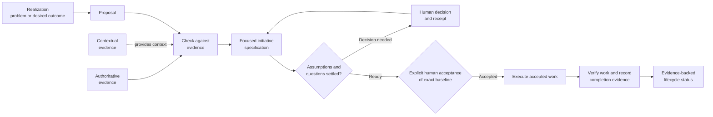
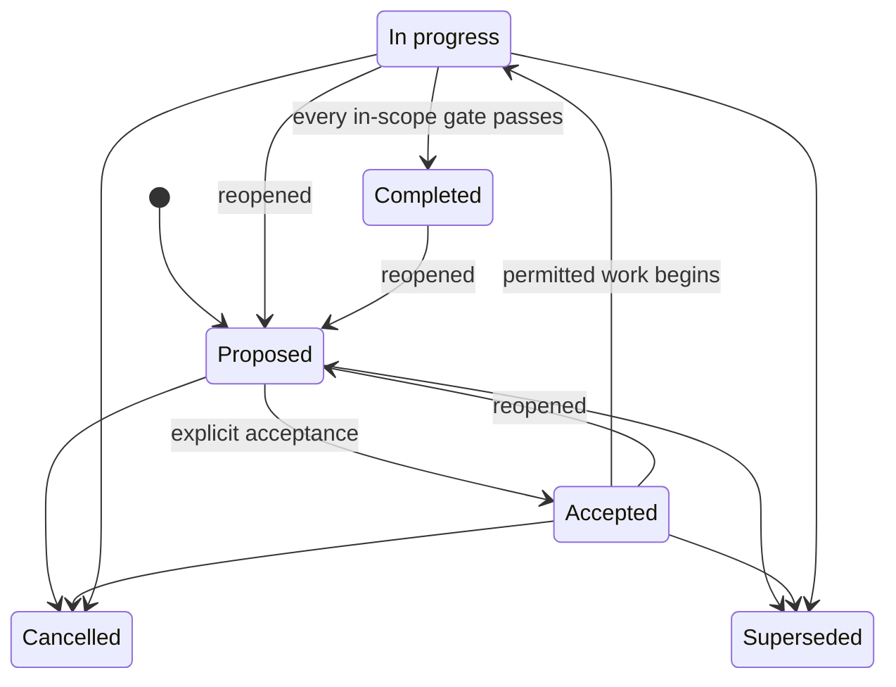

# Traceable Architecture Design Protocol (TADp)

TADp is a protocol for managing LLM-assisted software development work. It turns
evidence and explicit human decisions into focused initiatives that developers
can review and verify. For each initiative, TADp records **why the work exists**,
**who approved it**, **what developers agreed to do**, **what changed**, and
**what evidence shows the result**.

TADp is designed for software architecture work with Git using Codex. It is most
useful when developers need to explain what a system does, how each decision
gained authority, and what evidence supports completion. Its structured records
help coordinate complex systems with multiple components or services; use a
small pilot to assess the record-keeping cost for a smaller project.
The reference protocol and its complete documentation live in
[`protocol/`](protocol/README.md).

## The problem TADp is trying to solve

Software projects often lose the connection between architecture decisions and
delivered work:

- Requirements lose their links to source evidence.
- Observations or code details are treated as approved decisions.
- Broad initiatives combine unrelated goals, owners, and acceptance criteria.
- Unresolved assumptions quietly become requirements.
- Specifications are revised after implementation to match the code.
- Completion is claimed without evidence for the exact result that was
  promised.

TADp addresses these failures by giving every record a clear purpose and level
of authority. It links each stage of the work and pauses for human decisions at
defined approval points. A lifecycle status can change only after verification.

### LLM-assisted development

LLMs can speed up research, planning, coding, and verification. However, their
convincing output may be based on incomplete information.

Without an explicit protocol, an LLM may create these problems:

- It may treat observations as requirements.
- It may resolve assumptions without human approval.
- It may expand the work beyond its approved scope.
- It may revise a specification to match generated output.
- It may claim completion without evidence that the approved result was
  achieved.

TADp makes LLM-assisted work reviewable. It records the scope, authority,
assumptions, decisions, acceptance criteria, and verification evidence in the
repository. LLMs may assist throughout the workflow, but people remain
responsible for open questions and decisions that could have major effects.
Completion depends on recorded evidence, not on the model's confidence.

## How TADp works

The arrows show traceability between stages, not automatic promotion from one
stage to the next. A realization is not a requirement. A proposal does not
approve work. Likewise, code cannot rewrite the specification that governs it,
and a status label cannot prove completion on its own.

Each initiative covers one clear outcome within one authority boundary. It also
has one acceptance claim that reviewers can judge on its own. The authority
boundary identifies the people and records that can approve the work. Work
that can be accepted, verified, released, or cancelled on its own belongs in a
separate initiative.

## Authority model

TADp separates the content of information from its level of authority:

1. **Authoritative evidence** defines binding rules called invariants.
2. **Accepted decisions and initiative specifications** apply only to their
   recorded scope and must follow the invariants.
3. **Verified products** show what developers delivered, but their existence
   does not give them architectural authority.
4. **Non-authoritative evidence** provides observations, research, examples,
   and advice, but it cannot override a source with more authority.

When sources disagree, TADp preserves both claims and records the authority and
scope of each one. It then routes the conflict for resolution. TADp does not
create the appearance of consistency by hiding uncertainty or lowering the
standard for acceptance.

## Initiative lifecycle

Every lifecycle status is a claim that must be supported by evidence. When an
initiative is reopened, TADp records the event and preserves its history.
Reopening does not erase an earlier acceptance or completion.

Open initiative effort counts as work to reconcile, including proposed and
partially performed effort. Completion reviews consider the other open
initiatives and route useful refinements through their governed workflows.
Conflicting efforts remain visible in a work-conflict register; closed claims
require recorded authorized reopening before refinement. Adopted realization intake delegates necessary reopening while changed claims retain human acceptance. See the
[coherence rule](protocol/evidence/authoritative/LLM/10_Codex_Initiative_Coherence_Specification.md).

## What TADp provides

The current distribution supports major, minor and patch version scopes,
precise realization-note provenance, shared or dedicated execution branches,
and separately gated local integration into the immediate parent. Each narrow
initiative keeps independent acceptance and completion evidence. Adoption is
explicit; installed tools do not migrate historical work. See
[scope operation and migration](protocol/docs/guides/version-scope-migration.md).

The [canonical coverage map](protocol/template/TEMPLATE-COVERAGE.md) identifies
reusable files, embedded sections, conditional records and response shapes.
Workflow prompts prepare recoverable documentary prerequisites from scoped
evidence through their owning stages before checking entry gates. Missing
authority, identity, actual work and verification still block affected work.
Stage 9 assesses readiness read-only after disclosed preparation. See
[template use and recovery](protocol/docs/guides/template-prerequisites-migration.md).

The canonical [prompt keyword specification](protocol/evidence/authoritative/LLM/11_Codex_Prompt_Keyword_Specification.md)
applies to every TADp task. It adds positional settings, bounded exception
records, declared action-list scheduling, and a protected extensible registry.
Its defaults preserve ordinary gates and locks. The
[adoption guide](protocol/docs/guides/prompt-keywords-migration.md) explains
compatibility and how to request a new keyword.

- rules for ranking evidence so developers can separate binding authority from
  background context;
- templates for proposals, assumptions, decisions, specifications, plans, work
  records, and completion evidence;
- a step-by-step Codex workflow with clear human decision points;
- Git branch and history rules that make work easier to review;
- directory-scoped Codex guards, SHA-256 locks, and a pre-commit gate that
  protect reusable templates and the authoritative LLM invariant suite;
- a validator that checks structure, traceability, and protected-source
  integrity; and
- a reusable project structure for adopting TADp in another repository.

TADp does not replace architectural judgment, product tests, security reviews,
release checks, or human approval. Passing structural validation confirms only
that the checked records use the required structure and links. It does not
prove that the product is correct or ready for production.

## Repository guide

| Path | Purpose |
|---|---|
| [`protocol/README.md`](protocol/README.md) | Full protocol overview and documentation index |
| [`protocol/evidence/`](protocol/evidence/README.md) | Rules for authoritative and supporting evidence |
| [`protocol/initiatives/`](protocol/initiatives/README.md) | Rules for focused initiative records |
| [`protocol/template/`](protocol/template/README.md) | Reusable templates for projects, initiatives, and workflows |
| [`protocol/docs/`](protocol/docs/README.md) | Guides for setup, architecture, workflows, and development |
| [`protocol/tools/`](protocol/tools/README.md) | Validator and instructions for using it |
| [`protocol/tests/`](protocol/tests/test_tadp_validate.py) | Tests for the validator |

## Start here

1. Read the [protocol overview](protocol/README.md).
2. Review [architecture and authority](protocol/docs/development/architecture-and-authority.md)
   to learn which records can govern a decision.
3. Follow [getting started](protocol/docs/development/getting-started.md) to
   install the project scaffold at a selected directory inside a Git worktree.
   The [installation-root guide](protocol/docs/guides/project-root-installation-migration.md)
   explains project root versus Git root and prospective adoption.
4. Enable the tracked hook and verify the template and invariant locks before
   specializing any copied records.
5. Use the [initiative workflow](protocol/docs/development/initiative-workflow.md)
   to run a small trial with one outcome and one acceptance claim.
6. Run the validator and the project's own checks before review.

TADp requires **Git** and **Codex**. Python 3 is also required to run the
validator and its tests, although the validator uses only the Python standard
library.

For protocol maintenance, the [protocol hook](protocol/.githooks/pre-commit)
validates and guards `protocol/`. From the repository root, its setup command
is `git config core.hooksPath protocol/.githooks`; inspect existing hook
configuration and validation findings before making that local change.
Set `TADP_PYTHON` to the configured Python executable when it differs from the
shell default. A nested project's hook path includes its prefix relative to the
Git root. All projects in one worktree share hook configuration; coordinate
existing hooks manually before explicit activation. Copying installs no hooks.
The older [root hook](.githooks/pre-commit) still expects a local `example/`
tree and needs separately authorized executable maintenance. Examples are
outside this repository's protocol-maintenance validation target.

## Example repository

The example has a separate [repository](https://github.com/spkvfx/TADp-example).
Its clone URL is `https://github.com/spkvfx/TADp-example.git`. These supplied
links identify its location; rebuild status, protocol adoption, feature parity
and application behavior have not been verified by this documentation review.
For TADp adoption, follow [getting started](protocol/docs/development/getting-started.md).
