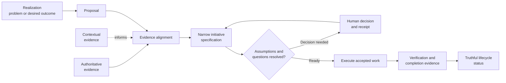
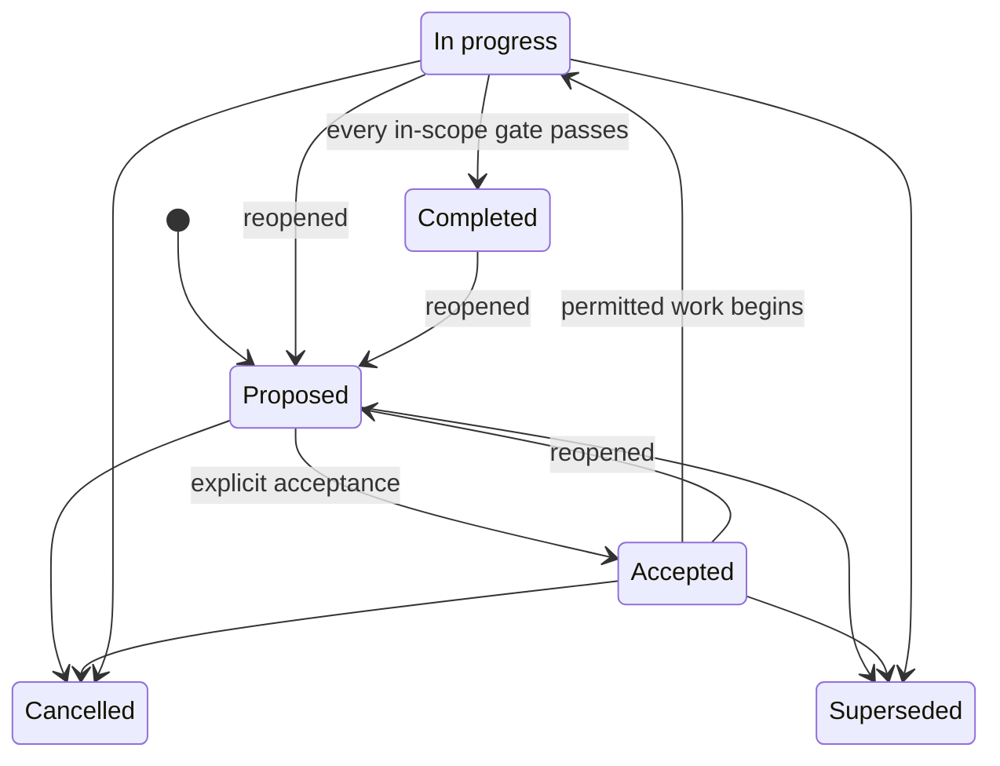

# Traceable Architecture Design Protocol (TADp)

TADp is a repository-centered protocol for turning evidence and explicit human
decisions into narrowly scoped, reviewable, and verifiable software
initiatives. It preserves the chain from **why work exists**, through **who
authorized it** and **what was accepted**, to **what changed** and **what proves
the result**.

The protocol is intended for architecture-heavy work performed with Git and
Codex, especially when a team must be able to explain not only what the current
system does, but how a decision became authoritative and whether a completion
claim is justified.

The reference protocol and its complete documentation live in
[`protocol/`](protocol/README.md).

## The problem TADp is trying to solve

Software projects often lose traceability between architecture and delivery:

- requirements become detached from their original evidence;
- observations or implementation details are mistaken for binding decisions;
- large initiatives mix unrelated outcomes, owners, and acceptance criteria;
- unresolved assumptions are silently converted into requirements;
- specifications are changed after the fact to match implementation; and
- work is marked complete without evidence for the exact claim being made.

TADp addresses these failure modes by separating artifacts according to their
role and authority, linking every stage of work, placing human decisions at
explicit gates, and requiring verification before lifecycle status changes.

## How TADp works

The arrows represent traceability, not automatic promotion. A realization is
not a requirement, a proposal does not authorize execution, an implementation
does not rewrite its governing specification, and a status label does not
prove completion.

Every initiative owns one coherent outcome, one authority boundary, and one
independently reviewable acceptance claim. Work that can be accepted,
verified, released, or cancelled independently is split into a separate
initiative.

## Authority model

TADp keeps information's *standing* separate from its content:

1. **Authoritative evidence** defines binding invariants.
2. **Accepted decisions and initiative specifications** authorize only their
   recorded scope and must remain compatible with those invariants.
3. **Verified products** show what was delivered, but do not become
   architectural authority merely because they exist.
4. **Non-authoritative evidence** supplies observations, research, examples,
   and recommendations without overriding higher-standing evidence.

When sources conflict, TADp preserves the competing claims, identifies their
authority and scope, and routes the contradiction for resolution. It does not
manufacture consistency by deleting uncertainty or weakening the acceptance
claim.

## Initiative lifecycle

Lifecycle state is an evidence-backed claim. Reopening is recorded as an event
that preserves prior history; it is not a status that erases an earlier
accepted or completed claim.

## What TADp provides

- an evidence hierarchy that distinguishes binding authority from context;
- templates for proposals, assumptions, decisions, specifications, plans,
  execution records, and completion evidence;
- a staged Codex workflow with explicit human decision points;
- Git-based branch and history requirements for reviewable work;
- a validator for machine-checkable structure and traceability rules; and
- reusable project scaffolding for adopting the protocol elsewhere.

TADp is not a replacement for architectural judgment, product tests, security
review, release qualification, or human acceptance. Passing structural
validation means the checked records are coherent; it does not prove that the
product is correct or ready for production.

## Repository guide

| Path | Purpose |
|---|---|
| [`protocol/README.md`](protocol/README.md) | Complete protocol overview and documentation index |
| [`protocol/evidence/`](protocol/evidence/README.md) | Authoritative and non-authoritative evidence model |
| [`protocol/initiatives/`](protocol/initiatives/README.md) | Rules for narrowly bounded initiative records |
| [`protocol/template/`](protocol/template/README.md) | Reusable project, initiative, and workflow templates |
| [`protocol/docs/`](protocol/docs/README.md) | Adoption, architecture, workflow, and development guides |
| [`protocol/tools/`](protocol/tools/README.md) | Reference validator and usage notes |
| [`protocol/tests/`](protocol/tests/test_tadp_validate.py) | Validator regression tests |

## Start here

1. Read the [protocol overview](protocol/README.md).
2. Review [architecture and authority](protocol/docs/development/architecture-and-authority.md)
   to understand which records can govern a decision.
3. Follow [getting started](protocol/docs/development/getting-started.md) to
   adopt the protocol in a Git repository.
4. Use the [initiative workflow](protocol/docs/development/initiative-workflow.md)
   for a small pilot with one outcome and one acceptance claim.
5. Run the validator and project-specific checks before review.

TADp explicitly requires **Git** and **Codex**. Python 3 is also needed to run
the bundled validator and its tests; the validator itself uses only the Python
standard library.
