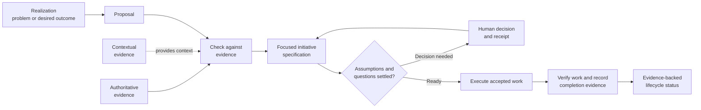
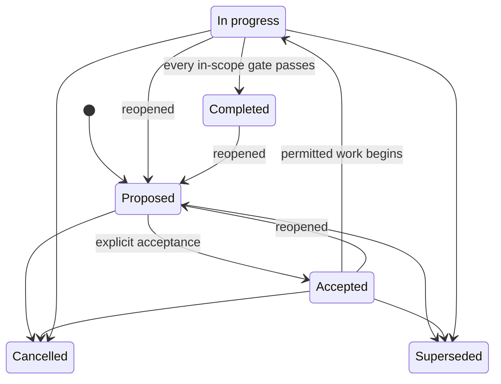

# Traceable Architecture Design Protocol (TADp)

TADp is a protocol for managing software work in a Git repository. It turns
evidence and clear human decisions into focused software initiatives that a
team can review and verify. It keeps a record of **why the work exists**, **who
approved it**, **what the team agreed to do**, **what changed**, and **what
evidence shows the result**.

TADp is designed for software architecture work done with Git and Codex. It is
most useful when a team needs to explain more than what a system does. The team
must also be able to show how each decision gained authority and why it believes
the work is complete.

The reference protocol and its complete documentation live in
[`protocol/`](protocol/README.md).

## The problem TADp is trying to solve

Software projects often lose the link between architecture decisions and
delivered work:

- requirements are no longer linked to their source evidence;
- observations or code details are mistaken for approved decisions;
- large initiatives combine unrelated goals, owners, and standards for
  accepting the work;
- open assumptions become requirements without a human decision;
- specifications are changed later to match the code; and
- work is marked complete without evidence for the exact result that was
  promised.

TADp addresses these problems by giving each record a clear purpose and level
of authority. It links every stage of the work, requires human decisions at
clear approval points, and requires verification before a lifecycle status can
change.

### LLM-assisted development

LLMs can speed up research, planning, coding, and verification. They can also
create convincing work from incomplete information.

Without an explicit protocol, an LLM may:

- treat observations as requirements;
- decide an assumption without telling anyone;
- add work outside the approved scope;
- change a specification to match its own output; or
- claim completion without proof that it achieved the approved result.

TADp keeps the scope, authority, assumptions, decisions, acceptance rules, and
verification evidence in the repository for review. LLMs can help throughout
the workflow, but people decide open questions and choices that may have major
effects. Recorded evidence, not the model's confidence, determines whether a
completion claim is justified.

## How TADp works

The arrows show how each stage links to the next. They do not mean that one
record automatically becomes another. A realization is not a requirement. A
proposal does not approve work. Code cannot rewrite the specification that
governs it. A status label alone does not prove that work is complete.

Each initiative has one clear outcome, one authority boundary, and one
acceptance claim that reviewers can judge on its own. The authority boundary
defines which people and records can approve the work. If work can be accepted,
verified, released, or cancelled on its own, it belongs in a separate
initiative.

## Authority model

TADp separates what information says from how much authority it has:

1. **Authoritative evidence** defines binding rules called invariants.
2. **Accepted decisions and initiative specifications** approve only the scope
   they record. They must follow the invariants.
3. **Verified products** show what the team delivered. They do not become
   architecture rules just because they exist.
4. **Non-authoritative evidence** provides observations, research, examples,
   and advice. It cannot override a source with more authority.

When sources disagree, TADp keeps both claims and records the authority and
scope of each one. It then routes the conflict for a decision. TADp does not
hide a conflict by removing uncertainty or lowering the standard for
acceptance.

## Initiative lifecycle

A lifecycle status is a claim supported by evidence. If an initiative is
reopened, TADp records the event and keeps the earlier history. Reopening does
not erase a previous accepted or completed status.

## What TADp provides

- rules for ranking evidence so teams can separate binding authority from
  background context;
- templates for proposals, assumptions, decisions, specifications, plans, work
  records, and completion evidence;
- a step-by-step Codex workflow with clear human decision points;
- Git branch and history rules that make work easier to review;
- a validator that checks structure and traceability rules; and
- a reusable project structure for adopting TADp in another repository.

TADp does not replace sound architecture decisions, product tests, security
reviews, release checks, or human approval. Passing structural validation only
shows that the checked records follow the required structure and links. It
does not prove that the product is correct or ready for production.

## Repository guide

| Path | Purpose |
|---|---|
| [`protocol/README.md`](protocol/README.md) | Full protocol overview and documentation index |
| [`protocol/evidence/`](protocol/evidence/README.md) | Rules for authoritative and supporting evidence |
| [`protocol/initiatives/`](protocol/initiatives/README.md) | Rules for focused initiative records |
| [`protocol/template/`](protocol/template/README.md) | Reusable templates for projects, initiatives, and workflows |
| [`protocol/docs/`](protocol/docs/README.md) | Guides for setup, architecture, workflows, and development |
| [`protocol/tools/`](protocol/tools/README.md) | Validator and instructions for using it |
| [`protocol/tests/`](protocol/tests/test_tadp_validate.py) | Tests for the validator |

## Start here

1. Read the [protocol overview](protocol/README.md).
2. Review [architecture and authority](protocol/docs/development/architecture-and-authority.md)
   to learn which records can govern a decision.
3. Follow [getting started](protocol/docs/development/getting-started.md) to
   set up TADp in a Git repository.
4. Use the [initiative workflow](protocol/docs/development/initiative-workflow.md)
   to run a small trial with one outcome and one acceptance claim.
5. Run the validator and the project's own checks before review.

TADp requires **Git** and **Codex**. Running the validator and its tests also
requires Python 3. The validator uses only the Python standard library.
