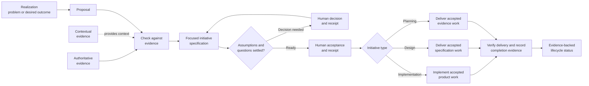
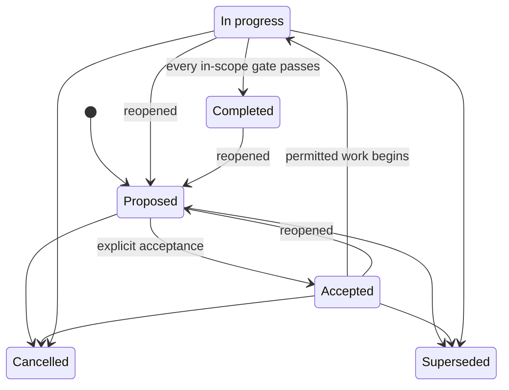

# Traceable Architecture Design Protocol (TADp)

TADp is a protocol for rigorous LLM-assisted software development in a Git
repository. It turns evidence and explicit human decisions into focused
initiatives that an LLM can help deliver and that people can review and verify.
For each initiative, TADp records **why the work exists**, **who approved it**,
**what developers agreed to do**, **what changed**, and **what evidence shows
the result**.

LLM collaboration is an intended part of TADp, not an optional layer added
afterward. Git and Codex are required parts of the reference workflow. Codex
helps maintain the detailed specifications, cross-record reconciliation, and
evidence trail; people retain the decision and acceptance authority assigned
to them by the protocol. TADp is most useful when developers must explain what a
system does, how each decision gained authority, and what evidence supports
completion.

The reference protocol and its complete documentation live in
[`protocol/`](protocol/README.md).

## The problem TADp is trying to solve

Software projects often lose the connection between architecture decisions and
delivered work:

- Requirements lose their links to source evidence.
- Observations or code details are treated as approved decisions.
- Broad initiatives combine unrelated goals, owners, and acceptance criteria.
- Unresolved assumptions quietly become requirements.
- Specifications are revised after implementation to match the code.
- Completion is claimed without evidence for the exact result that was
  promised.

TADp addresses these failures by giving every record a clear purpose and level
of authority. It links each stage of the work and pauses for human decisions at
defined approval points. A lifecycle status can change only after verification.

### LLM-assisted development

LLM assistance is TADp's intended operating model. The protocol asks for enough
structured specification, traceability, and reconciliation that running it
entirely by hand is theoretically possible but usually impractical for a
substantial project. The LLM carries much of that organizational and drafting
load; it does not gain authority to decide what is true, approved, or complete.

That distinction matters because convincing LLM output may be based on
incomplete information.

Without an explicit protocol, an LLM may create these problems:

- It may treat observations as requirements.
- It may resolve assumptions without human approval.
- It may expand the work beyond its approved scope.
- It may revise a specification to match generated output.
- It may claim completion without evidence that the approved result was
  achieved.

TADp makes LLM-assisted work reviewable. It records the scope, authority,
assumptions, decisions, acceptance criteria, and verification evidence in the
repository. LLMs may assist throughout the workflow, but people remain
responsible for the decisions and acceptance gates assigned to human authority.
Completion depends on recorded evidence, not on the model's confidence.

## Project fit

TADp is best suited to larger, long-lived, or architecturally significant
projects, especially when work crosses many dependencies, contributors,
authority boundaries, or release gates. Its detailed records and workflow
stages are deliberate overhead that pays off when traceability and controlled
change matter.

For a small prototype, short-lived script, or low-risk application, TADp will
usually be overkill. A lighter process is generally a better fit unless even a
small project has unusually strong assurance, regulatory, audit, or handoff
requirements.

## How TADp works



The arrows show traceability between stages, not automatic promotion from one
stage to the next. A realization is not a requirement. A proposal does not
approve work. Likewise, code cannot rewrite the specification that governs it,
and a status label cannot prove completion on its own.

Each initiative covers one clear outcome within one authority boundary. It also
has one acceptance claim that reviewers can judge on its own. The authority
boundary identifies the people and records that can approve the work. Work
that can be accepted, verified, released, or cancelled on its own belongs in a
separate initiative.

## Authority model

TADp separates the content of information from its level of authority:

1. **Authoritative evidence** defines binding rules called invariants.
2. **Accepted decisions and initiative specifications** apply only to their
   recorded scope and must follow the invariants.
3. **Verified products** show what developers delivered, but their existence
   does not give them architectural authority.
4. **Non-authoritative evidence** provides observations, research, examples,
   and advice, but it cannot override a source with more authority.

When sources disagree, TADp preserves both claims and records the authority and
scope of each one. It then routes the conflict for resolution. TADp does not
create the appearance of consistency by hiding uncertainty or lowering the
standard for acceptance.

## Initiative lifecycle



Every lifecycle status is a claim that must be supported by evidence. When an
initiative is reopened, TADp records the event and preserves its history.
Reopening does not erase an earlier acceptance or completion.

## What TADp provides

- rules for ranking evidence so developers can separate binding authority from
  background context;
- templates for proposals, assumptions, decisions, specifications, plans, work
  records, and completion evidence;
- a step-by-step Codex workflow with clear human decision points;
- an explicit acceptance stage followed by separate implementation, design,
  and planning delivery paths;
- Git branch and history rules that make work easier to review;
- a validator that checks structure and traceability rules; and
- a reusable project structure for adopting TADp in another repository.

TADp does not replace architectural judgment, product tests, security reviews,
release checks, or human approval. Passing structural validation confirms only
that the checked records use the required structure and links. It does not
prove that the product is correct or ready for production.

## Repository guide

| Path | Purpose |
|---|---|
| [`protocol/README.md`](protocol/README.md) | Full protocol overview and documentation index |
| [`protocol/evidence/`](protocol/evidence/README.md) | Rules for authoritative and supporting evidence |
| [`protocol/initiatives/`](protocol/initiatives/README.md) | Rules for focused initiative records |
| [`protocol/template/`](protocol/template/README.md) | Reusable templates for projects, initiatives, and workflows |
| [`protocol/docs/`](protocol/docs/README.md) | Guides for setup, architecture, workflows, and development |
| [`protocol/tools/`](protocol/tools/README.md) | Validator and instructions for using it |
| [`protocol/tests/`](protocol/tests/test_tadp_validate.py) | Tests for the validator |

## Start here

1. Read the [protocol overview](protocol/README.md).
2. Review [architecture and authority](protocol/docs/development/architecture-and-authority.md)
   to learn which records can govern a decision.
3. Follow [getting started](protocol/docs/development/getting-started.md) to
   set up TADp in a Git repository.
4. Use the [initiative workflow](protocol/docs/development/initiative-workflow.md)
   to run a small trial with one outcome and one acceptance claim.
5. Run the validator and the project's own checks before review.

From this reference repository's root, run:

```powershell
python protocol/tools/tadp_validate.py protocol
python -m unittest discover -s protocol/tests -v
```

TADp requires **Git** and **Codex**. Python 3 is also required to run the
validator and its tests, although the validator uses only the Python standard
library.
